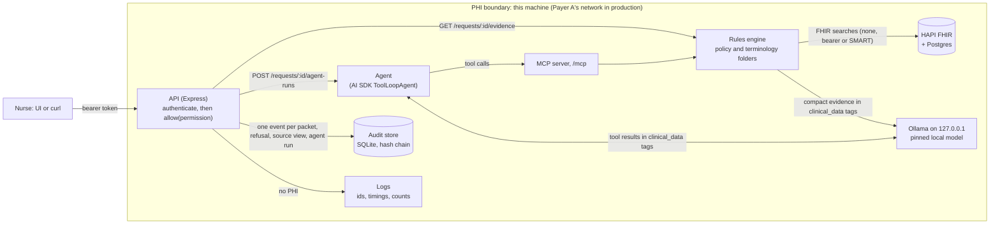

# pa-evidence

Evidence packets for utilization review of GLP-1 requests (synthetic data only).

Work in progress. The build plan is in [docs/BUILD-PLAN.md](docs/BUILD-PLAN.md), the decisions are in
[DECISIONS.md](DECISIONS.md), and the hours are in [HOURS.md](HOURS.md). The full README is written in Phase 9.

## ⚠ Two places we read the brief over the build plan

The answer key (`eval/expected/`, written by hand before any rules code) departs from the original build plan on two C3
(metformin) rules. The brief settled the first one:

> "Only one of the seven requests meets policy. Others are missing a document, fail a criterion, or contain a conflict
> between what the prescriber attests and what the record shows." (assignment brief)

1. **PA-004: an attestation conflict counts even when C3 is met another way.** The plan said a months mismatch is only a
   warning when C3 is met through intolerance (path B). Under that rule PA-004 meets all five criteria: its record has a
   confirmed metformin intolerance. That makes **two** of the seven meet policy, which the sentence above rules out. The prescriber attests a
   6-month metformin trial; the record shows 21 days. The policy file says *"Where the prescriber attestation and the record
   disagree, mark the criterion conflicting and cite both"*, and conflicting *"takes precedence over met"*. So PA-004 C3 is
   **conflicting**, and the packet cites both the stopped order and the intolerance for the nurse.
2. **PA-005: the metformin months check is one-sided.** The brief defines conflicting as the form disagreeing with the record
   *"on a fact the criterion depends on"*. PA-005 attests 30 months, and the record shows 32.5 months of active therapy. The record supports more than
   was claimed, so nothing contradicts the 90-day requirement. A two-sided ±1 month check would mark it conflicting and ask
   the provider to prove 30 months the chart already shows. So C3 is conflicting only when the form claims **more** than the
   record supports (by more than 1 month). PA-005 keeps its one designed issue: resolved pancreatitis, C4 not met.

With both rules the seven requests line up with the brief: one meets policy, and each of the other six has exactly one issue
(one missing, two not met, three conflicting). Details: [eval/expected/NOTES.md](eval/expected/NOTES.md), decisions D-028 and D-029 in
[DECISIONS.md](DECISIONS.md).

## Data notes: one hand-made change, and what looks odd

All data is synthetic. The supplied files and the Synthea sample are never edited; their checksums (`data/CHECKSUMS.sha256`,
`data/synthea/SHA256SUMS`) still match.

- **One chart has a result added by hand: SYN-011.** No Synthea sample patient can be evidence complete: only 2 of the 112 ever have
  an HbA1c of 7 % or more, the latest in March 2025, before the policy takes effect on 2026-07-01. To test the complete path on
  Synthea data, SYN-011 is SYN-001 resubmitted after the HbA1c the nurse asked for was recorded. `eval/synthea-overlays/SYN-011.json`
  adds that one result (7.6 % on 2026-10-23); `pnpm load` loads it after the sample, and the record itself carries the tag
  `synthea-overlay`. It is dated after SYN-001's request, so SYN-001's packet does not change. The other ten Synthea requests use
  the sample as generated. EVAL.md and EVAL.html name the overlaid chart (D-089).
- **What looks implausible in the data.** Each item is a finding in `eval/findings.json`, listed in EVAL.md:
  - Synthea HbA1c values are implausibly low for treated diabetics: 3.11 % every month for one patient, 4.01 % for another (F-005).
  - eGFR comes in two units, with mL/min values of 6 to 13 in patients without kidney disease (F-006).
  - Past Synthea metformin orders have no end date, so only a still-active order can show a trial's length (F-007).
  - A member who died in 2008 still has active diabetes (F-008). Prediabetes stays active beside diabetes in five charts (F-017).
    One chart has diabetic complications but no diabetes diagnosis, HbA1c or eGFR (F-018).
  - Supplied PA-007 marks diabetes resolved while metformin is active and the HbA1c is 8.4 % (F-009). PA-006 hides an instruction in
    free text (F-010; see the security notes).

## Why the agent loop is the AI SDK's

The agent runs on the Vercel AI SDK's `ToolLoopAgent`, with the SDK's MCP client and its OpenAI-compatible
provider for the local model. The original plan called for a hand-written ReAct loop, and writing one is easy: a
`for` loop, a `map` over tool calls, an array of messages. That ease is the problem. Like rolling your own crypto, it
is simple to write and simple to get subtly wrong: message bookkeeping, parallel tool calls, step limits, malformed
tool calls, timeouts, provider quirks. A loop we own also never improves on its own. The library's loop is shared,
tested and maintained, and we pick up its fixes and improvements by upgrading a pinned version.

We keep our own code only where it is simpler or more secure than what the SDK offers, and each piece is a control the
SDK cannot know about:
- tool results go back to the model inside `<clinical_data>` tags (prompt injection, OWASP LLM01)
- the agent's packet is built in code from the tool results it actually received (the model never restates a status),
  compared with the rules engine's packet, and the route is computed in code
- the summary and the provider-request draft are checked for faithfulness, retried once with the problems, and replaced
  by code templates if they still fail
- the browser receives only server-built, checked events over SSE, never the model's raw token stream

(Decision D-067 in [DECISIONS.md](DECISIONS.md).)

## Changing the model

Which model runs, and how it is called, is data, handled like a policy update: one folder per version,
`data/models/<effective date>_<version>/model.json`, holding the model's name and pinned digest, the call settings
(temperature, seed), the output caps, the timeouts (one call, and a whole agent run) and the agent's step limit. The
latest folder whose date is on or before today is the one in use; a later-dated folder is staged and takes over on
its day. To try a new model: copy the current folder to a new one, change the name and digest, run `make model`
(pulls it and checks the digest), then `make reload-models` (no restart; a folder that fails validation changes
nothing, and `/ready` names the problem). Old folders stay as the record of what ran when.

The prompts are not in that folder. They are code (`apps/api/src/core/llm/prompts/`), because the code depends on what
they say: the `<clinical_data>` tags the code wraps data in, the JSON shapes its schemas parse, the summary rules its
checker enforces, and the tool order the agent's stop condition relies on. A new model that needs different prompts is
a code change, which runs the tests and the eval. (D-070, D-071.)

## What runs so far

Needs Docker Desktop, Node 24 and pnpm 12.

```sh
pnpm install
make tokens    # nurse/admin/probe tokens: hashes to .env, plaintext to .tokens.local (both gitignored)
make up        # checks native Ollama + the pinned model, starts HAPI + Postgres + the API, loads the Synthea sample and the 7 bundles
make reload-policies   # pick up a dropped-in data/policies/<id>/<effective>_<version>/ folder without a restart
make reload-models     # pick up a dropped-in data/models/<effective>_<version>/ folder (run make model first)
pnpm agent PA-004      # run the agent from the terminal: its tool calls, its packet against the rules engine, the draft
make down      # stop (data kept)   |   make reset   # stop and delete the data
```

| Port (this machine only) | What |
|---|---|
| `http://localhost:8080` | the API; the UI at `/ui` |
| `http://localhost:8090/fhir` | HAPI FHIR |

```sh
NURSE=$(grep '^nurse=' .tokens.local | cut -d= -f2)
curl -i http://localhost:8080/requests/PA-001/evidence                            # 401 Unauthenticated
curl -H "Authorization: Bearer $NURSE" http://localhost:8080/requests/PA-001/evidence
curl -H "Authorization: Bearer $NURSE" http://localhost:8080/audit                 # 403 forbidden (admin only)
```

```sh
pnpm lint      # ESLint (with the import boundaries) + TypeScript
pnpm test      # vitest: rules engine, API, audit, auth, loader, guard tests
pnpm test:ui   # Playwright against Vite with a mocked API   (review: pnpm test:ui:report)
pnpm test:e2e  # Playwright against the running stack (make up) (review: pnpm test:e2e:report)
pnpm eval         # all 17 requests through the running service against the answer key -> eval/results/, EVAL.md, EVAL.html
pnpm eval:models  # each candidate model on every request, 1 run -> eval/results/models-*.json and .html, EVAL.md
pnpm eval:models -- --requests PA-004                    # a test run on a sample -> eval/results/samples/ (EVAL.md untouched)
pnpm eval:models:html eval/results/models-<run id>.json  # re-render a comparison's HTML page (open it in any browser)
```

On this Mac the GPU faults and then hangs under Ollama, so everything runs CPU-only: `brew services stop ollama`, then
`make ollama-cpu OLLAMA_CPU_PORT=11434` in its own terminal. The API, the tests and `make up` then need no change. The comparison
takes about an hour and a half for the five candidates. D-085 and D-090 have the details.

The UI at `http://localhost:8080/ui`: paste a token from `.tokens.local` to sign in. A packet that needs clinician
review has a "Draft provider request" panel; the agent runs only when it is clicked, streams its tool calls, and
shows an editable draft (never sent automatically) and its packet next to the rules engine's.

## Data flow



## The agent is a second front door (item 3)

`GET /requests/{id}/evidence` never calls the agent. It runs the rules engine and asks the model only for the two-sentence summary.
The agent (`POST /requests/{id}/agent-runs`, or `pnpm agent PA-004`) is a second front door to the same rules: it calls the MCP tools
at `/mcp`, and they call the same core functions as the endpoint. Why:
- **The endpoint stays deterministic.** The same request gives the same statuses with or without a model; if the model is down, the
  summary falls back to a code template and `/ready` still passes.
- **A 3–4B local model is too slow and too unreliable for the nurse's main path.** EVAL.md has the measurements per model.
- **Every agent disagreement is visible.** The agent's packet is built in code from the tool results it actually received (the model
  never restates a status) and compared with the rules engine's packet, criterion by criterion. The agent's only nurse-facing output
  is a draft provider request, which code checks and which never changes a status.
- **Giving it a larger role later means shadow mode first:** run it beside the endpoint on live cases and measure agreement.

## Security notes (item 7)

Code decides every criterion status and the route. The model writes the two-sentence summary and the agent drafts the provider
request; code checks both. So an attack on the model can at worst spoil a summary or a draft, and the checks below catch that.

### Prompt injection (OWASP LLM01)

- **Only compact evidence reaches the model:** per criterion the id, requirement, status, value and date, plus counts and the provider
  asks. No patient id, no clinical notes or narrative, no free-text request notes (D-064).
- **Data is tagged, with a stated rule.** That evidence, and every MCP tool result the agent sees, goes inside `<clinical_data>` tags,
  and the system prompt says content inside the tags is data, never instructions.
- **Every model output is checked.** It is parsed with a Zod schema, then checked for faithfulness: exactly two sentences; numbers and
  dates only from the evidence; each criterion id with its real status; every unmet criterion named; no wrong count or "all met"
  claim; no recommendation words or FHIR references (D-061). One retry with the problems listed, then the code template. Model text is
  accepted or rejected, never edited (D-068).
- **Banned words:** every JSON response, SSE event and MCP tool result passes the same check for any form of the three decision words.
- **Tested against the supplied attack.** PA-006 hides an instruction to pass the request in a Condition note and in an office-note
  DocumentReference. Neither reaches the model, and the source view strips `note`, `text` and attachment data. The injection test
  plants instructions in every free-text place a chart or form has, and checks that statuses, sources, route and asks are unchanged,
  that the planted text never reaches the model, and that a model obeying an injected instruction is caught and falls back.
- **The path that remains:** a criterion `value` can carry a matched record's display text (a diagnosis name, say). The tags, the rule
  and the checker cover it.
- **The trade-off:** evidence that exists only in free text (a clinical note) does not appear in the packet.

### PHI boundary (OWASP LLM02): local inference or an external provider

The model receives clinical values, so the model host sits inside the PHI boundary. With local inference that boundary is this
machine: Ollama runs natively and listens on 127.0.0.1 only (never `OLLAMA_HOST=0.0.0.0`), and HAPI and the API bind to 127.0.0.1 too.
No prompt leaves the machine, and there is no vendor logging or retention to manage. The cost: a 3–4B model on CPU is slower and
weaker than a hosted model, and we pin and patch it ourselves (model version folders with digests, D-070).

An external provider (the code already speaks the OpenAI-compatible API) would need:
- a BAA with the provider, and zero data retention with no training on our data, in writing;
- an egress path from Payer A's network, allow-listed to that one endpoint;
- to know what the provider logs (prompts, outputs, abuse monitoring), for how long, and in which region.

Minimum necessary applies either way: prompts carry no name, birth date or member id, but clinical values with dates are still PHI.
The schemas, the faithfulness check and the banned-word check run the same with either provider.

## Enterprise minimum (item 8)

**Authentication and roles.** The demo uses a static token map: `AUTH_TOKENS` holds `role:subject:sha256(token)` entries (hashes only,
compared in constant time), written by `make tokens`. `nurse` reads packets; `admin` also reads the audit trail and health detail and
reloads policies and models; `probe` reads `/health` for the container healthcheck. Every route is mounted after `authenticate` and
carries `allow(<permission>)`. No token or a bad one answers 401 `unauthenticated`, a wrong role 403 `forbidden`, and each refusal
writes an audit event. Production replaces the token map with an OIDC JWT check (the IdP's JWKS, roles from SSO group claims) behind
the same `IdentityVerifier` interface, so no route changes.

**Audit trail.** One append-only event per packet request, refusal, source view and agent run, in SQLite (`node:sqlite`): who asked,
when, request id, member reference, policy id and version, a fingerprint of the rules applied, model, digest and prompt version, cited
sources, route and warnings. No clinical values. `GET /audit?request_id=` returns them to an admin. Tamper evidence: each event's hash
is sha256 of the previous hash plus the event's canonical JSON, triggers reject UPDATE and DELETE, and `GET /audit/verify` recomputes
the whole chain (someone with file access could drop the triggers; the chain still shows the change). In production the chain head is
anchored on a schedule to write-once storage (S3 Object Lock) or a signed checkpoint, and a copy streams to the SIEM, so even a rewrite
of the whole file shows up.

**PHI hygiene.** Logs carry the request id, the route pattern (never the URL, which holds FHIR ids), status, timings and counts. One
line from a packet request:

```json
{"level":30,"time":"2026-10-26T21:42:16.914Z","pid":1,"hostname":"c7e7ad240942","req":{"id":"668b01f6-bd25-47d6-ab21-f79e145f76da","method":"GET"},"route_pattern":"/requests/:id/evidence","request_id":"PA-004","fhir_ms":21,"llm_ms":935,"sources":5,"warnings":1,"route":"clinician_review","res":{"statusCode":200},"responseTime":958,"msg":"request completed"}
```

The request id, the timings (FHIR, model, total), how many sources and warnings, the route and the status code. No member reference,
no FHIR ids, no clinical value, no header or body.

The packet keeps the brief's fields. Each extra field is there because the nurse checks something with it:

| Field | Why |
|---|---|
| `request_date` | every window and age is computed from it |
| `policy_version` | which version's rules applied |
| `summary_source` | whether the model or the code template wrote the summary |
| `warnings` | blocking problems (an unverified source, a drug not on the policy's list) that force clinician review |
| criterion `kind` | how the criterion was evaluated (a lab threshold, a medication duration, …) |
| criterion `attested` | the request form's value next to the record's, for conflicts (form values never go in `sources`) |
| criterion `considered` | every record looked at and why it was or was not used, so a `not_met` or `missing` can be checked |
| criterion `window`, `threshold` | the window and threshold actually applied |
| criterion `paths` | each alternative way to meet the criterion (a metformin trial, or a documented intolerance) and its status |
| criterion `missing_document` | the ask for this criterion; `missing_documents` is built from these |

The member appears only as a FHIR reference (`patient`).

**FHIR server credentials.** `FHIR_AUTH` is `none` (local HAPI), `bearer` (`FHIR_BEARER_TOKEN`) or `smart` (SMART Backend Services
client credentials with a signed JWT assertion, the `SMART_*` variables). `.env.example` documents every variable; `.env` and
`.tokens.local` are gitignored.

**Operability.** `GET /health` is liveness. `GET /ready` checks the FHIR server, the audit store and the policies (the model is
optional, because summaries fall back), and only an admin sees the per-dependency detail. Images are pinned by digest, models by digest
in their version folders, and `make up` starts the whole stack.
